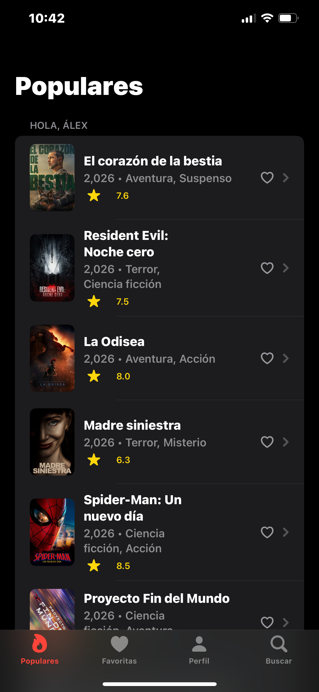
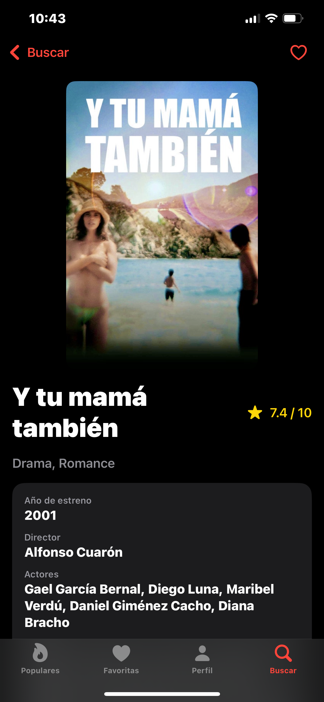
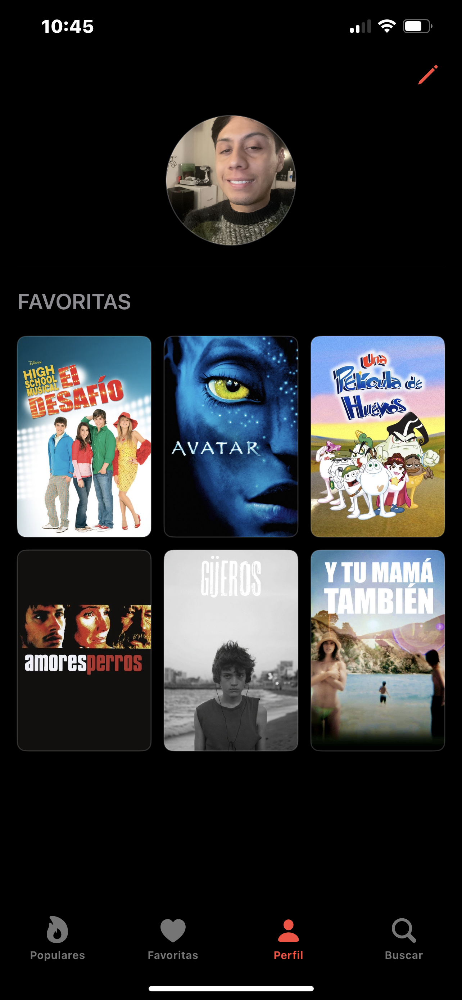
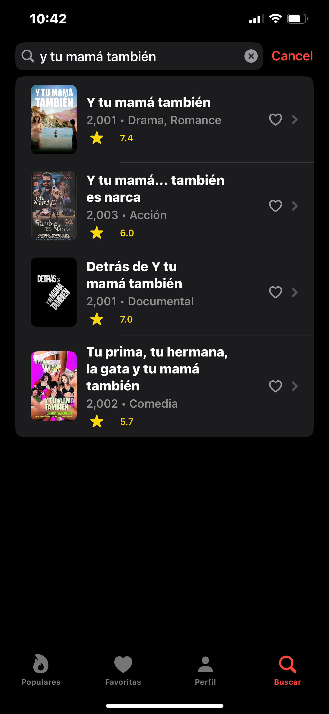
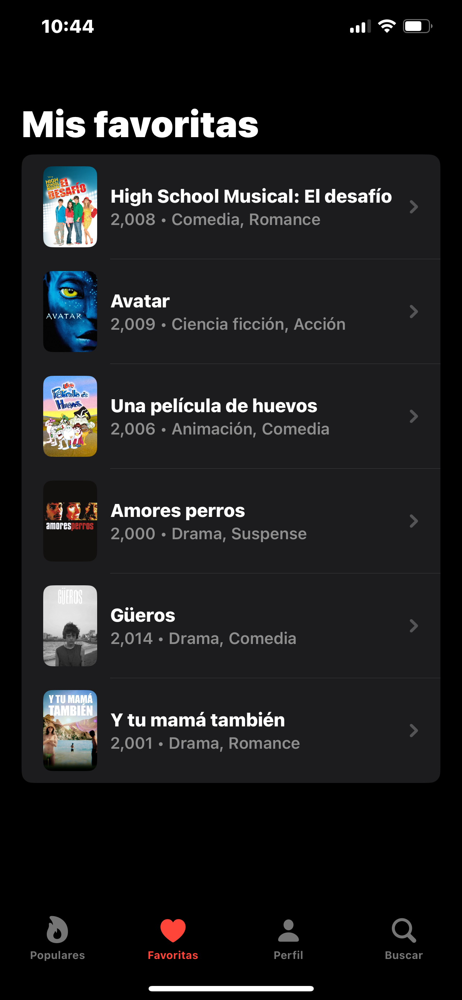
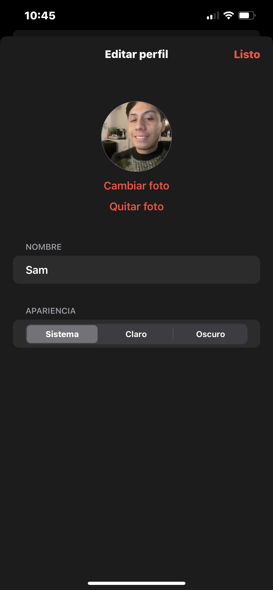
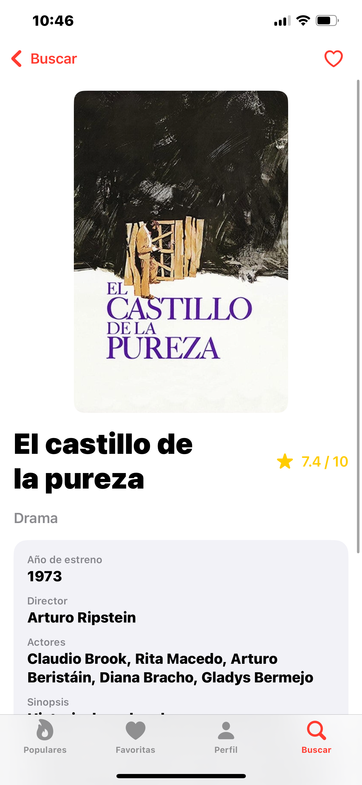
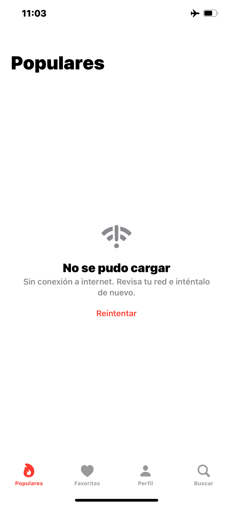
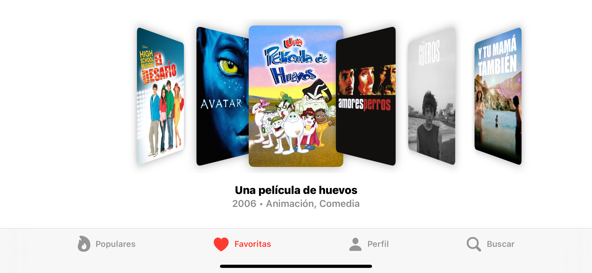
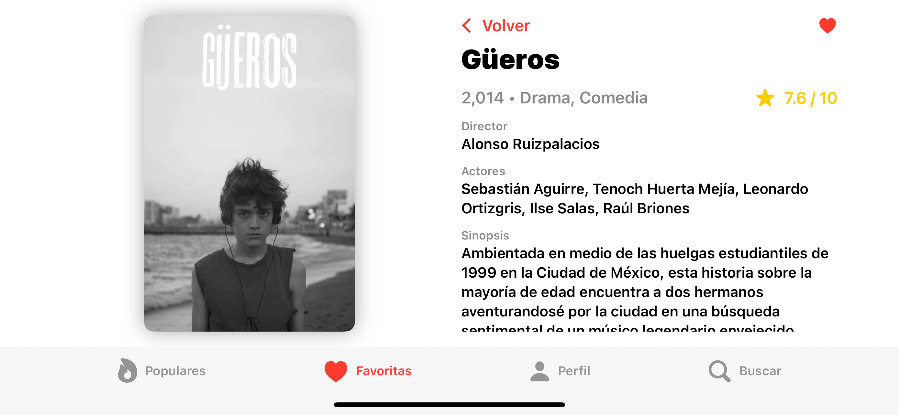

# PeliQlas

Aplicación móvil nativa para iOS, desarrollada con Swift y SwiftUI, para descubrir películas populares, buscar por título, consultar su ficha completa (sinopsis, director y elenco) y guardar una lista personal de favoritas en el dispositivo.

<p align="center">
  
  
  
</p>

## Descripción

Los catálogos de las plataformas audiovisuales son enormes y la información de cada película está dispersa. PeliQlas ofrece una interfaz limpia y rápida para explorar cine desde un iPhone: ver las películas en tendencia, buscar títulos específicos en español (es-MX) y guardar recomendaciones personales para consultarlas después, sin cuentas externas.

## Funcionalidades

- **Películas populares:** catálogo en tendencia obtenido en tiempo real desde TMDB, con indicador de carga, mensaje de error con botón **Reintentar**, estado vacío y actualización con pull-to-refresh.
- **Búsqueda por título:** consulta la API mientras se escribe, con una espera de 0.5 s (debounce) para no hacer una solicitud por cada letra.
- **Detalle de película:** póster remoto, calificación, año, géneros, **director**, **actores** y **sinopsis**.
- **Favoritas con persistencia local:** agregar o quitar con el corazón desde el detalle; sin duplicados; se conservan al cerrar la app. En la pestaña Favoritas se pueden eliminar deslizando la fila.
- **Perfil:** foto circular editable, portadas de las películas favoritas (cada una abre su detalle) y botón de edición para cambiar nombre, foto y tema.
- **Tema claro, oscuro o del sistema:** seleccionable desde el perfil.
- **Cover Flow en horizontal:** al girar el dispositivo, Populares y Favoritas se muestran como un carrusel con efecto 3D. Al tocar la película central, su póster se desliza a la izquierda y a la derecha aparece su información.
- **Navegación por pestañas:** Populares, Favoritas, Perfil y Buscar.

## Capturas de pantalla

| Populares | Búsqueda | Detalle |
|---|---|---|
|  |  |  |

| Favoritas | Perfil | Editar perfil |
|---|---|---|
|  |  |  |

| Modo claro | Estado de error |
|---|---|
|  |  |

**Cover Flow (horizontal)**

 

## Tecnologías

- **Lenguaje:** Swift 5.9+
- **Interfaz:** SwiftUI (`TabView`, `NavigationStack`, `AsyncImage`, `PhotosPicker`, `scrollTransition`)
- **Persistencia:** SwiftData (favoritas) y `@AppStorage` (nombre, foto y tema)
- **Networking:** `URLSession` con `async/await` y `JSONDecoder`
- **Registro de errores:** OSLog (`Logger`)
- **Pruebas:** XCTest
- **API externa:** The Movie Database (TMDB) API v3
- **Control de versiones:** Git y GitHub

## Requisitos

- macOS Sonoma 14.0 o superior
- Xcode 15.1 o superior
- iOS 17.2 o superior como versión mínima de despliegue (SwiftData y `scrollTransition` lo requieren)
- Conexión a internet para consultar el catálogo, buscar y descargar pósteres
- Cuenta gratuita en TMDB para obtener un *API Read Access Token*

## Instalación y configuración

1. Clona el repositorio:

   ```bash
   git clone https://github.com/jsamuelbt1/peliQlas.git
   cd peliQlas
   ```

2. Crea el archivo de credenciales siguiendo la sección [Configuración de servicios externos](#configuración-de-servicios-externos). Está excluido del repositorio con `.gitignore`, así que **debes crearlo antes de compilar**.

3. Abre el proyecto: `PeliQlas/PeliQlas.xcodeproj`.

## Configuración de servicios externos

La app usa la API v3 de TMDB y autentica cada solicitud con un token `Bearer` en el encabezado `Authorization`. Para configurarlo sin exponer credenciales:

1. Crea una cuenta en [themoviedb.org](https://www.themoviedb.org).
2. Ve a **Ajustes → API** y copia el **API Read Access Token** (el texto largo que empieza con `eyJ`). No es la API Key corta.
3. En Xcode, haz clic derecho sobre la carpeta `PeliQlas/PeliQlas/` → **New File… → Swift File** → `APIConfig`. Verifica que esté marcado el target **PeliQlas**.
4. Pega este contenido y sustituye el token:

   ```swift
   import Foundation

   enum APIConfig {
       static let baseURL = "https://api.themoviedb.org/3"
       static let imageBaseURL = "https://image.tmdb.org/t/p/w500"
       static let accessToken = "<TU_TOKEN_DE_ACCESO_TMDB>"
   }
   ```

> **Nunca subas este archivo a GitHub.** Ya está en `.gitignore`. Si publicaste un token por error, regéneralo en TMDB.

## Ejecución

1. Con `APIConfig.swift` creado y el proyecto abierto, espera a que Xcode termine de indexar.
2. En la barra superior elige el esquema **PeliQlas** y un simulador con iOS 17.2 o superior (por ejemplo, iPhone 15), o tu iPhone conectado.
3. Presiona `⌘R` para compilar y ejecutar.
4. Para ver el **Cover Flow**, gira el dispositivo a horizontal (en el simulador: `⌘←` o `⌘→`) estando en Populares o Favoritas.
5. Para ejecutar las pruebas unitarias, presiona `⌘U`.

## Documentación técnica

### Arquitectura

El proyecto sigue **MVVM** con la capa de red desacoplada mediante un protocolo:

```
PeliQlas/
├── PeliQlas/
│   ├── Models/
│   │   ├── Movie.swift              # Modelo de dominio que usan las vistas
│   │   ├── Movie+Display.swift      # Textos ya formateados (subtítulo, calificación)
│   │   ├── MovieDTO.swift           # Modelos Decodable que reflejan el JSON de TMDB
│   │   ├── MovieMapper.swift        # Convierte DTO -> Movie y completa con el detalle
│   │   └── FavoriteMovie.swift      # Entidad persistente (@Model) de SwiftData
│   ├── ViewModels/
│   │   ├── MovieListViewModel.swift   # Estado y consulta de películas populares
│   │   ├── SearchViewModel.swift      # Búsqueda con debounce
│   │   ├── MovieDetailViewModel.swift # Carga de director, reparto y sinopsis
│   │   └── CoverFlowViewModel.swift   # Lógica de selección del Cover Flow
│   ├── Views/
│   │   ├── MainTabView.swift        # Pestañas y cambio a Cover Flow en horizontal
│   │   ├── MovieListView.swift      # Pestaña Populares
│   │   ├── SearchView.swift         # Pestaña Buscar
│   │   ├── FavoritesView.swift      # Pestaña Favoritas
│   │   ├── ProfileView.swift        # Perfil con foto y portadas
│   │   ├── EditProfileView.swift    # Edición de nombre, foto y tema
│   │   ├── MovieDetailView.swift    # Detalle de película
│   │   ├── CoverFlowView.swift      # Carrusel, detalle horizontal y variantes
│   │   ├── MovieRowView.swift       # Fila reutilizable
│   │   └── PosterView.swift         # Póster remoto con respaldo
│   ├── MovieService.swift           # Capa de red y MovieServiceProtocol
│   ├── APIError.swift               # Errores de red tipados
│   ├── FavoritesManager.swift       # Agregar, quitar y consultar favoritas
│   ├── APIConfig.swift              # (Local, ignorado por Git) URL base y token
│   └── PeliQlasApp.swift            # Punto de entrada y ModelContainer
├── PeliQlasTests/                   # Pruebas unitarias
└── PeliQlasUITests/                 # Estructura base de pruebas de interfaz
```

**Responsabilidades**

| Capa | Componente | Responsabilidad |
|---|---|---|
| Model | `Movie`, `FavoriteMovie`, DTOs, `MovieMapper` | Describir los datos y convertir entre el formato de la API y el de la app |
| View | Archivos de `Views/` | Dibujar según el estado que reciben y avisar las acciones del usuario. No conocen HTTP ni JSON |
| ViewModel | `MovieListViewModel`, `SearchViewModel`, `MovieDetailViewModel`, `CoverFlowViewModel` | Lógica de pantalla, estado de la consulta y reglas de selección |
| Service | `MovieService`, `FavoritesManager` | Comunicación con TMDB y operaciones sobre la colección de favoritas |

**Flujo de la información:** la View observa al ViewModel (`@Published`); el ViewModel pide los datos al servicio, los convierte con `MovieMapper` y actualiza su estado; la View se redibuja sola. El ViewModel no conoce a la View.

**Estados de interfaz.** Las pantallas con consulta remota usan un `enum ViewState` como única fuente de verdad:

| Estado | Qué se muestra |
|---|---|
| `idle` / `loading` | Indicador de progreso |
| `loaded` | Lista de películas |
| `empty` | Mensaje de que la consulta fue exitosa, pero sin resultados |
| `failed` | Mensaje de error y botón **Reintentar** |


### Networking

Toda la comunicación está en `MovieService` (implementa `MovieServiceProtocol`): construye la solicitud con `URLComponents` y `URLRequest`, la ejecuta con `URLSession` y `async/await`, valida que la respuesta sea `HTTPURLResponse` con código 200-299 y decodifica con `JSONDecoder` (`.convertFromSnakeCase`). Todas las solicitudes llevan `language=es-MX` y un tiempo de espera de 15 s.

**API:** The Movie Database (TMDB) v3, `https://api.themoviedb.org/3`.

| Endpoint | Funcionalidad que alimenta |
|---|---|
| `GET /movie/popular` | Pestaña Populares y Cover Flow |
| `GET /search/movie?query={texto}` | Pestaña Buscar |
| `GET /movie/{id}?append_to_response=credits` | Detalle: director, actores y sinopsis, en una sola solicitud |

Los pósteres se descargan con `AsyncImage` desde `https://image.tmdb.org/t/p/w500` + `poster_path`.

**Modelos de respuesta**

- `MovieListResponseDTO`: envoltorio con `results: [MovieDTO]`.
- `MovieDTO`: datos básicos (`id`, `title`, `overview`, `releaseDate`, `voteAverage`, `posterPath`, `genreIds`).
- `MovieDetailDTO`: incluye `genres` y `credits` (`cast` y `crew`). El director es el miembro de `crew` con `job == "Director"` y se muestran los 5 primeros actores.

**Errores:** `APIError` cubre URL inválida, sin conexión, tiempo agotado, cancelación, respuesta inválida, error HTTP (código fuera de 200-299) y error de decodificación, cada uno con un mensaje legible para el usuario.

### Persistencia

| Información | Mecanismo | Detalle |
|---|---|---|
| Películas favoritas | **SwiftData** (`@Model FavoriteMovie`, `ModelContainer`, `ModelContext`, `@Query`) | Se guarda una copia de los datos (título, año, géneros, calificación, director, actores, URL del póster y fecha). `@Attribute(.unique)` sobre `movieID` evita duplicados |
| Nombre, foto y tema | **`@AppStorage`** (`UserDefaults`) | Preferencias simples del perfil. La foto se reduce a 400 px antes de guardarse |

Todo se almacena en el dispositivo y se conserva al cerrar la app. Los errores de guardado se registran con `Logger` y no se silencian.

### Decisiones técnicas

- **MVVM con protocolo de servicio:** los ViewModels dependen de `MovieServiceProtocol` y no de `MovieService`, lo que permite probarlos con un servicio falso sin internet.
- **DTOs separados del modelo de dominio:** si TMDB cambia su JSON, solo se ajusta `MovieMapper`.
- **`enum ViewState`** en lugar de varias variables sueltas (`isLoading`, `error`, `movies`): evita combinaciones imposibles, como mostrar a la vez el indicador de carga y el error.
- **Un solo `MovieListViewModel` compartido** entre la lista y el Cover Flow, creado en `MainTabView`, para no consultar la API dos veces.
- **`CoverFlowBrowser` reutilizable:** recibe `[Movie]` y no sabe si vienen de la API o de SwiftData, así Populares y Favoritas comparten el mismo componente.
- **Lógica fuera de las vistas:** la selección del Cover Flow y el formato de textos viven en `CoverFlowViewModel` y `Movie+Display`, lo que permite probarlos con XCTest.
- **Debounce en la búsqueda:** `.task(id:)` cancela la tarea anterior al cambiar el texto y se espera 0.5 s antes de consultar.
- **Cancelación sin error:** una solicitud cancelada (por ejemplo, al salir de la pantalla) vuelve a `idle` sin mostrar un fallo.
- **Favoritas como copia de datos:** se guarda la película completa y no solo el id, para poder mostrarla sin volver a consultar la API.
- **Token fuera del repositorio:** `APIConfig.swift` está en `.gitignore`.

### Pruebas

Las pruebas unitarias (`PeliQlasTests`, XCTest) no dependen de internet: usan datos fijos y un `MockMovieService`. Cubren la búsqueda por título (caso normal, límite y sin resultados), los estados de carga (éxito, error HTTP, sin conexión y vacío), la búsqueda con la API y la lógica de selección del Cover Flow. Se ejecutan con `⌘U`.


### Limitaciones conocidas

- **Sin caché de la lista:** sin conexión, Populares muestra el error en lugar de datos guardados. Las favoritas sí se ven, pero sus pósteres necesitan internet.
- **Solo la primera página:** Populares y Buscar muestran los primeros ~20 resultados; no hay paginación.
- **Favoritas antiguas:** las guardadas antes de integrar la API usaban ids de datos de ejemplo y no coinciden con los de TMDB. Se recomienda borrar la app para empezar limpio.
- **Favoritas sin director ni sinopsis actualizados:** al abrir su detalle se consultan de nuevo, pero el registro guardado no se actualiza hasta quitar y volver a marcar el corazón.
- **Cover Flow:** al girar el dispositivo, la pestaña reconstruye su contenido y, si estabas dentro de un detalle, vuelves a la lista.
- **Foto de perfil en `@AppStorage`:** es suficiente para una sola foto reducida, pero para varios perfiles o imágenes grandes convendría guardarla como archivo.
- **Sin sincronización:** las favoritas y el perfil viven solo en el dispositivo; no se comparten entre equipos ni sobreviven a desinstalar la app.
- **Barra inferior:** el estilo flotante de cristal solo aparece en iOS 26; en versiones anteriores se ve la barra clásica.
- **Pruebas de interfaz:** `PeliQlasUITests` solo contiene la estructura base.
- **Un solo idioma:** la app está en español (es-MX).

## Integrantes

- Alyn Rivera Abreu
- José Samuel Badillo Toledo
